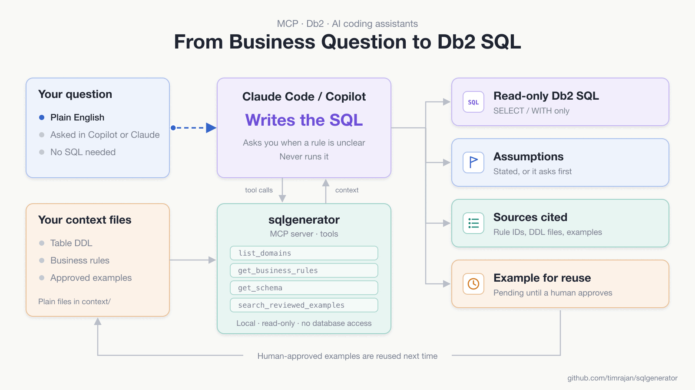

# sqlgenerator

**Ask a business question in plain English. Get Db2 SQL that follows your
team's own rules, without waiting for the one person who knows the database.**

## The problem

Someone asks a simple-sounding question: *"How many active customers in
postcode 2020 are over 40?"*

Answering it is rarely simple. The data is spread across many tables with
cryptic names. You need to know which table holds the customer, which holds
the address, how they join, and which rows count as "active". You also need
the unwritten rules: a column that looks right but is out of date, a status
code that means something special, a join that quietly doubles every row.

That knowledge usually lives in one or two people's heads. Every new question
goes into their queue. Developers, testers, and analysts wait. The experts
spend their days answering the same kinds of questions instead of doing their
own work. When they go on leave, the answers stop.

## The idea

Writing the SQL isn't the hard part. Once you know the tables, how they
connect, and the business rules, the query almost writes itself. The hard
part is **knowing the context**.

So write that context down once, as plain files:

- **The database structure:** the table definitions.
- **The business rules:** what "active customer" means, which columns to
  trust, which joins to avoid.
- **Good past queries:** examples that an expert has reviewed and approved.

Then let an AI assistant you already use (GitHub Copilot or Claude Code) read
that context and write the SQL for you. It shows its working: the tables and
rules it used, the assumptions it made, and where it got them from. When
something is unclear, it asks you instead of guessing.

The expert's job changes from *writing every query* to *reviewing the
knowledge once*. Approved queries are reused next time, so the system gets
better with every question.



## What this repo is

A local **MCP server** that helps AI coding assistants (Claude Code, GitHub
Copilot in VS Code) write **Db2 SQL from business questions**. It does this by
supplying your schema definitions, business rules, and human-reviewed SQL
examples.

- The **AI client writes the SQL.** This server only provides context.
- **No database access.** No Db2 connection, drivers, credentials, SQL execution, or EXPLAIN.
- **No extra LLM.** No API keys, LangChain, Ollama, embeddings, or web UI.
- **Human-curated example library.** Queries become reusable only after a human approves them in a terminal.

> The bundled `customer` domain is **FICTIONAL demo data**. Replace it before real use.

---

## How it works

```
 Claude Code / Copilot  ──stdio (MCP)──►  sqlgenerator server (Node.js)
   (writes the SQL)                            │ reads only
                                               ▼
                                  context/
                                    manifest.json        domains, tables, docs, version, Db2 platform
                                    schema/**/*.sql      DDL per table
                                    business-rules/**/*.md
                                    examples/approved/   human-approved (searchable)
                                    examples/pending/    awaiting review (not searchable)
                                    examples/rejected/   audit trail (not searchable)
                                    examples/demo/       fictional practice seed

 You (human) ── npm run review ──► moves pending → approved / rejected
```

| Layer | Code | Role |
|---|---|---|
| MCP entry point | `src/server.ts` | Starts the stdio server and registers the tools |
| Tools | `src/tools/` | Input validation (zod) and the seven MCP tools |
| Services | `src/services/` | Keyword search, context assembly, example logic, review flow, advisory lint |
| Repositories | `src/repositories/` | Safe file access, manifest loading, example store (locking, atomic writes) |
| Review CLI | `src/cli/review.ts` | Human-only approve/reject |

### MCP tools

| Tool | Kind | Purpose |
|---|---|---|
| `list_domains` | read | Domains, their tables and rule IDs, context version, Db2 platform |
| `search_context` | read | Ranked keyword search over rules and table descriptions (bounded excerpts and source paths) |
| `get_business_rules` | read | Full rule documents for a domain, with SHA-256 hashes and paths |
| `get_schema` | read | Stored DDL for exact `SCHEMA.TABLE` names (case-sensitive; suggests near misses) |
| `search_reviewed_examples` | read | Searches **approved examples only**, with review metadata and staleness check |
| `get_reviewed_example` | read | One complete approved example |
| `submit_example_for_review` | **write** | Creates a **pending** example only. It can't approve anything or mark SQL as tested. |

No tool approves examples, executes SQL, or runs shell commands.

Search is deterministic keyword/tag scoring (`src/services/keywordSearch.ts`):
weighted fields, ties broken by ID, and limits clamped to `SQLGEN_MAX_RESULTS`
(default 25; the default page size is 5).

---

## Prerequisites

- **Node.js 22 LTS or newer** (developed with Node 22.23.1; the MCP SDK v2 requires ≥ 20)
- **npm** (developed with npm 10.9.8)
- For clients: **Claude Code** and/or **VS Code with GitHub Copilot** (agent mode with MCP support)

## Setup

```bash
git clone https://github.com/timrajan/sqlgenerator.git
cd sqlgenerator
node --version    # must print v22 or newer (see Troubleshooting if not)
npm ci            # or: npm install
npm run build
npm run test:all  # typecheck + unit tests + MCP smoke test
```

The project includes `.npmrc` with `bin-links=false`, so `npm install` also
works on exFAT or FAT drives, which can't hold the symlinks npm normally
creates in `node_modules/.bin`. All npm scripts call tools as
`node node_modules/...`, so they work with or without bin links on any OS.
Keep the setting; it does no harm on other drives.

### npm scripts

| Script | What it does |
|---|---|
| `npm run dev` | Runs the server from TypeScript source via tsx (stdio; for manual debugging) |
| `npm run build` | Compiles `src/` to `dist/` |
| `npm start` | Starts the compiled MCP server (`node dist/server.js`) |
| `npm run typecheck` | Strict type-check of `src/` and `tests/` |
| `npm test` | Unit tests (Node test runner; temp directories only) |
| `npm run test:smoke` | Builds, then runs the MCP client ↔ server integration smoke test |
| `npm run test:all` | All of the above |
| `npm run review -- <cmd>` | Human example-review CLI (builds first) |

### Configuration (environment variables, all optional)

| Variable | Default | Notes |
|---|---|---|
| `SQLGEN_CONTEXT_DIR` | `<project>/context` | Relative values resolve from the project root, not the shell's directory |
| `SQLGEN_EXAMPLES_DIR` | `<context>/examples` | |
| `SQLGEN_DEFAULT_RESULTS` / `SQLGEN_MAX_RESULTS` | 5 / 25 | |
| `SQLGEN_LOG_LEVEL` | `info` | `debug`/`info`/`warn`/`error`; logs go to **stderr** only |

---

## Where business knowledge is stored

Everything lives in `context/`. No business rules are hard-coded in TypeScript.

- **`context/manifest.json`** is the index. It holds:
  - `contextVersion`: bump this whenever rules or schema change.
  - `db2.platform`: `unspecified` | `luw` | `zos` | `ibmi`, plus `db2.version`.
  - `domains[]`: `id`, `name`, `description`.
  - `tables[]`: exact `name` (`SCHEMA.TABLE`), `domain`, `schemaPath`, `description`, `grain`, `primaryKey`, `tags`.
  - `documents[]`: `id`, `domain`, `title`, `path`, `tags`.
- **`context/schema/**.sql`**: one DDL file per table, returned verbatim.
- **`context/business-rules/**.md`**: Markdown rule documents, split by heading for search.
- **`context/examples/`**: JSON records validated with zod on every read.

All paths in the manifest are relative to `context/`. The server rejects
absolute paths, `..` traversal, and symlinks that resolve outside the context
directory. Tools accept only logical IDs and table names, never file paths.

## Demo schema (FICTIONAL)

The bundled `customer` domain has five tables in schema `APP`. It is sample
data for trying the server, not a real system. The source of truth is
`context/schema/customer/*.sql` and
`context/business-rules/customer/customer-table-relationships.md`. There is
also a diagram in [`docs/erd.md`](docs/erd.md).

**`APP.CUSTOMER_MASTER`**: one row per current customer. This is the default table for customer questions.

| Column | Type | Null? | Notes |
|---|---|---|---|
| `CUSTOMER_ID` | BIGINT | NOT NULL | **PK** |
| `CUSTOMER_NAME` | VARCHAR(200) | NOT NULL | Full name |
| `AGE` | SMALLINT | | Completed years |
| `RESIDENTIAL_POSTCODE` | VARCHAR(10) | | String; keep leading zeros |
| `STATUS` | VARCHAR(20) | NOT NULL | Values not defined |

**`APP.CUSTOMER_HISTORY`**: one row per customer version.

| Column | Type | Null? | Notes |
|---|---|---|---|
| `CUSTOMER_ID` | BIGINT | NOT NULL | **PK** (part 1) |
| `VERSION_NO` | INTEGER | NOT NULL | **PK** (part 2), starts at 1 |
| `CUSTOMER_NAME` | VARCHAR(200) | NOT NULL | |
| `AGE` | SMALLINT | | As recorded in this version |
| `RESIDENTIAL_POSTCODE` | VARCHAR(10) | | |
| `STATUS` | VARCHAR(20) | NOT NULL | |
| `VALID_FROM` | TIMESTAMP | NOT NULL | Start of validity (inclusive) |
| `VALID_TO` | TIMESTAMP | | End (exclusive); NULL for the latest version |

**`APP.CUSTOMER_APPLICATIONS`**: one row per application. Applicants are not necessarily customers.

| Column | Type | Null? | Notes |
|---|---|---|---|
| `APPLICATION_ID` | BIGINT | NOT NULL | **PK** |
| `APPLICANT_NAME` | VARCHAR(200) | NOT NULL | |
| `AGE` | SMALLINT | | At application date |
| `RESIDENTIAL_POSTCODE` | VARCHAR(10) | | |
| `APPLICATION_DATE` | DATE | NOT NULL | |
| `APPLICATION_STATUS` | VARCHAR(20) | NOT NULL | |
| `CUSTOMER_ID` | BIGINT | | **FK** → `CUSTOMER_MASTER`; NULL until the applicant becomes a customer |

**`APP.CUSTOMER_CONTACTS`**: one row per contact, with many contacts per customer.

| Column | Type | Null? | Notes |
|---|---|---|---|
| `CONTACT_ID` | BIGINT | NOT NULL | **PK** |
| `CUSTOMER_ID` | BIGINT | NOT NULL | **FK** → `CUSTOMER_MASTER` |
| `CONTACT_NAME` | VARCHAR(200) | NOT NULL | |
| `CONTACT_ROLE` | VARCHAR(50) | | Free text; values not defined |
| `EMAIL_ADDRESS` | VARCHAR(254) | | |
| `PHONE_NUMBER` | VARCHAR(30) | | |

**`APP.CUSTOMER_ARCHIVE`**: one row per former customer. Archived customers no longer appear in `CUSTOMER_MASTER`.

| Column | Type | Null? | Notes |
|---|---|---|---|
| `CUSTOMER_ID` | BIGINT | NOT NULL | **PK** |
| `CUSTOMER_NAME` | VARCHAR(200) | NOT NULL | |
| `AGE` | SMALLINT | | At time of archiving |
| `RESIDENTIAL_POSTCODE` | VARCHAR(10) | | At time of archiving |
| `STATUS` | VARCHAR(20) | NOT NULL | |
| `ARCHIVED_DATE` | DATE | NOT NULL | |
| `ARCHIVE_REASON` | VARCHAR(200) | | |

### Relationships

```
CUSTOMER_MASTER ──1:N──► CUSTOMER_CONTACTS       (FK CUSTOMER_ID)
CUSTOMER_MASTER ──1:N──► CUSTOMER_APPLICATIONS   (FK CUSTOMER_ID, nullable)
CUSTOMER_MASTER ┄┄1:N┄┄► CUSTOMER_HISTORY        (logical link, no FK)
CUSTOMER_ARCHIVE ┄1:N┄┄► CUSTOMER_HISTORY        (logical link, no FK)
CUSTOMER_ARCHIVE ✗ CUSTOMER_MASTER               (no link: archived customers left master)
```

- **Contacts repeat customer rows.** Joining contacts to master gives one row per contact, so count customers with `COUNT(DISTINCT CUSTOMER_ID)`.
- **History at a point in time T:** `VALID_FROM <= T AND (VALID_TO IS NULL OR VALID_TO > T)`.
- **Applicants are not customers.** Don't count them as customers.

If you change the DDL or relationship rules, update this section and `docs/erd.md` to match.
When you [replace the demo](#replacing-the-demo-context-with-real-documents),
replace or remove this section. The tests keep their own copy of this demo in
`tests/fixtures/context/`.

## Replacing the demo context with real documents

Everything you replace is under `context/`. No code changes are needed. The
tests use their own copy of the demo in `tests/fixtures/context/`, so they
keep passing after you replace `context/`.

1. **Remove the demo content:** delete `context/schema/customer/`,
   `context/business-rules/customer/` and the files in `context/examples/demo/`.
   Leave the empty `examples/approved/`, `pending/` and `rejected/` folders.
2. **Add your DDL files** under `context/schema/`, one table per file, with exact
   identifier casing (for example `context/schema/sales/SALES.ORDERS.sql`).
   On Db2 for LUW, your DBA team can export table definitions with the
   `db2look` utility, for example `db2look -d MYDB -z SALES -t ORDERS -e`. On
   z/OS or IBM i, ask them for the equivalent DDL export. Header comments describing
   grain and keys help the AI; the server returns the file as stored.
3. **Add business-rule documents** (Markdown) under `context/business-rules/`.
   They're optional at first: you can start with none and write rules where the
   AI guesses wrong. Use `##` headings, because search returns one section at a time.
4. **Rewrite `context/manifest.json`** using the template below.
5. **Update the documentation** for your data: replace or remove the
   [Demo schema](#demo-schema-fictional) section of this README and `docs/erd.md`.
6. **Check and restart:** run `npm run build` and `npm run test:all`, then
   restart your MCP client so it reloads the server. A manifest mistake is
   reported with the offending field when a tool is first called.
7. **Check that the data you put in `context/` is approved** for use with your
   AI client (see [Privacy](#limitations-and-privacy)).

### Manifest template

```json
{
  "contextVersion": "2026-10-22.1",
  "description": "Sales reporting context.",
  "fictional": false,
  "db2": { "platform": "unspecified", "version": null },
  "domains": [
    { "id": "sales", "name": "Sales", "description": "Orders and revenue." }
  ],
  "tables": [
    {
      "name": "SALES.ORDERS",
      "domain": "sales",
      "schemaPath": "schema/sales/SALES.ORDERS.sql",
      "description": "One row per customer order. Use for order counts and revenue.",
      "grain": "One row per order.",
      "primaryKey": ["ORDER_ID"],
      "tags": ["order", "orders", "revenue", "sales"]
    }
  ],
  "documents": [
    {
      "id": "order-rules",
      "domain": "sales",
      "title": "Order and revenue rules",
      "path": "business-rules/sales/order-rules.md",
      "tags": ["revenue", "orders"]
    }
  ]
}
```

| Field | Required? | Notes |
|---|---|---|
| `contextVersion` | Yes | Any text up to 64 characters. Change it whenever rules or schema change, so older examples are flagged as stale. |
| `db2.platform` | Yes | `unspecified`, `luw`, `zos` or `ibmi` |
| `db2.version`, `db2.notes`, `description`, `fictional` | No | `fictional` defaults to `false` |
| `domains[]`: `id`, `name`, `description` | Yes (at least one domain) | `id` is lowercase `a-z`, `0-9`, `_`, `-` |
| `tables[]`: `name`, `domain`, `schemaPath`, `description` | Yes | `name` is exactly `SCHEMA.TABLE`. `schemaPath` is relative to `context/`. |
| `tables[]`: `grain`, `primaryKey`, `tags` | No, but recommended | Search uses `description`, `grain` and `tags`, so add the words people actually use (synonyms, abbreviations). |
| `documents[]`: `id`, `domain`, `title`, `path` | Yes, but the list may be empty (`"documents": []`) | `path` is relative to `context/`. `tags` is optional. |

The server doesn't parse DDL. The manifest's descriptions, grain, keys and
tags are what search uses, so write them carefully.

---

## Connecting Claude Code

The project-scoped config is in `.mcp.json`:

```json
{ "mcpServers": { "sqlgenerator": { "type": "stdio", "command": "node",
    "args": ["${CLAUDE_PROJECT_DIR:-.}/dist/server.js"], "env": {} } } }
```

Claude Code sets `CLAUDE_PROJECT_DIR` to the project root. The `:-.` default
falls back to the launch directory if the variable is missing, so start
`claude` from the project root.

1. `npm run build`. The config points at `dist/server.js`.
2. Run `claude` from the project root. Claude Code asks you to **approve the project-scoped server** from `.mcp.json`; choose to approve it.
3. If you dismissed or rejected the prompt, run `claude mcp reset-project-choices`, then restart `claude`.
4. After rebuilding or changing `.mcp.json`, restart the Claude Code session so the server is relaunched.

Claude Code asks permission the first time each tool is used. Nothing in this
project auto-approves tools or changes your global settings. You can allow the
read-only tools in your own settings if you choose. Keep
`mcp__sqlgenerator__submit_example_for_review` on "ask".

**Verify:** `claude mcp list` should show `sqlgenerator` as connected, and
`claude mcp get sqlgenerator` shows details. Inside a session, `/mcp` lists the
server and its seven tools.

## Connecting GitHub Copilot in VS Code

The workspace config is in `.vscode/mcp.json`. VS Code uses `servers`, not `mcpServers`:

```json
{ "servers": { "sqlgenerator": { "type": "stdio", "command": "node",
    "args": ["${workspaceFolder}/dist/server.js"] } } }
```

`${workspaceFolder}` is VS Code syntax. Don't copy it into `.mcp.json`; Claude Code doesn't expand it.

1. `npm run build`, then open the `sqlgenerator` folder as the workspace root.
2. Open `.vscode/mcp.json`. VS Code shows a **Start** action above the server; or run **MCP: List Servers** → `sqlgenerator` → Start. Confirm the trust prompt.
3. Open Copilot Chat in **Agent** mode. Click the **tools** icon and check that the `sqlgenerator` tools are listed and enabled.
4. Copilot asks for confirmation before running tools; keep confirmation on for `submit_example_for_review`.
5. After rebuilding, restart the server (**MCP: List Servers** → Restart).

Copilot reads `.github/copilot-instructions.md`, and Claude Code reads `CLAUDE.md`.
These steer the assistant's behaviour; they are not a security sandbox.

---

## Walkthrough: your first customer query

**1. Ask** (in Claude Code or Copilot agent mode):

> Using the sqlgenerator MCP tools, write Db2 SQL to get customer IDs and names
> for customers aged 30 to 35 in postcode 3000.

**2. The assistant should retrieve context.** It calls `list_domains`, then
`get_business_rules({domain:"customer"})`, then
`get_schema({tables:["APP.CUSTOMER_MASTER"]})`, then
`search_reviewed_examples(...)` (empty until you approve something). From
these it learns:
- Use `APP.CUSTOMER_MASTER` by default.
- Age ranges are inclusive.
- Postcodes are strings.
- `STATUS` values are undefined.

**3. Expected answer shape:**

- **Interpretation:** current customers whose age in completed years is 30–35 inclusive and whose current home postcode is 3000.
- **Tables / rules:** `APP.CUSTOMER_MASTER`; `customer-search-rules`.
- **SQL:**
  ```sql
  SELECT CM.CUSTOMER_ID,
         CM.CUSTOMER_NAME
  FROM APP.CUSTOMER_MASTER AS CM
  WHERE CM.AGE BETWEEN 30 AND 35
    AND CM.RESIDENTIAL_POSTCODE = '3000'
  ORDER BY CM.CUSTOMER_ID
  ```
- **Assumptions:** no `STATUS` filter (values undefined); postcode compared as a string.
- **Sources:** `customer-search-rules`, `schema/customer/APP.CUSTOMER_MASTER.sql`.
- *"This SQL has not been executed or validated against Db2."*

**4. Try an ambiguous question,** such as *"How many active customers are in 3000?"*
The assistant should ask what "active" means, because the rules don't define `STATUS`.

**5. Revise** as needed ("order by name instead"), and run the SQL yourself in your own Db2 tooling if appropriate.

**6. Submit for reuse (only if you want to):**

> Submit this query for review as a reusable example.

The assistant calls `submit_example_for_review` and reports a pending ID like `ex-20261013-1a2b3c4d5e6f`.

## The pending → human review → approved loop

```bash
npm run review -- list                 # pending examples
npm run review -- show <id>            # full question, exact SQL, rules, assumptions, lint
npm run review -- approve <id>         # shows everything, then asks for name, notes,
                                       # and requires typing:  APPROVE <id>
npm run review -- reject <id>          # asks for name and reason, requires: REJECT <id>
npm run review -- rejected             # rejection history (audit)
npm run review -- seed-demo            # copy the FICTIONAL demo example into pending to practise
```

- **Interactive only.** Approval and rejection need a real terminal. Piped or redirected input is refused, and there is no `--yes` flag.
- **What approval records:** ID, question, exact SQL, domain, tables, rule IDs, context version at submission and at review, assumptions, tags, created and reviewed timestamps, reviewer name, review notes, `status: "approved"`, and `validationStatus: "human_reviewed_not_executed"`.
- **Reviewer names are self-reported.** This local version can't authenticate who typed them (`reviewerIdentityVerified: false`).
- **Immediate availability.** Approved examples are returned by the very next `search_reviewed_examples` call; the server re-reads the store on each call, so no restart is needed.
- **Rejections are retained** in `examples/rejected/` with the reason. They are never served. Resubmitting identical SQL is flagged with `previouslyRejected`.
- **Duplicates.** An identical question and SQL that is already pending or approved is refused. The comparison ignores question case and whitespace, SQL line endings and trailing whitespace, and a trailing `;`.
- **No overwrites, safe concurrency.** Writes go to a temp file, are fsynced, and are renamed only if the target doesn't exist. All store mutations hold a cross-process `mkdir` lock (`examples/.lock`), so the MCP server and CLI can run at the same time. Locks older than 30 s are treated as stale.
- **Staleness.** Each example stores the `contextVersion` it was reviewed against. If `manifest.json`'s version changes, results include `contextCheck.stale: true` and a warning that current rules take precedence. Warnings also appear if referenced tables or rules disappear.
- **Advisory lint.** Pending records include regex warnings (non-SELECT keywords, multiple statements, `SELECT *`). These are **advisory only** and do not prove the SQL is valid Db2 or safe.

The full diagram, including the clarification and revision loops, is in [docs/workflow.md](docs/workflow.md).
An entity-relationship diagram of the demo customer tables is in [docs/erd.md](docs/erd.md).

---

## Troubleshooting

| Symptom | Fix |
|---|---|
| `npm install` fails with `EPERM … symlink` | You're on exFAT/FAT. Keep `.npmrc` (`bin-links=false`). |
| `npm test` says `Could not find '…/tests/unit/**/*.test.ts'` | Your Node is older than 22, which can't expand that pattern. Check `node --version`. With nvm: `nvm install 22 && nvm alias default 22`. |
| Tests pass but the server returns old data | Restart your MCP client. It keeps the server process running until it's restarted. |
| Client shows the server as failed | Run `npm run build`; check `dist/server.js` exists; run `node dist/server.js` and check stderr for errors (press Ctrl+C to exit). |
| Claude Code doesn't list the server | Start `claude` in the project root; approve the project server; run `claude mcp reset-project-choices` if you declined earlier. |
| VS Code shows `${workspaceFolder}` errors | Open the `sqlgenerator` folder itself as the workspace, not a parent folder. |
| `manifest.json failed validation` | The message lists the offending fields. Table names must be `SCHEMA.TABLE`, and IDs must be lowercase `a-z0-9_-`. |
| `Table "app.customer_master" not found … did you mean` | Table names are exact and case-sensitive. Use the spelling from `list_domains`. |
| `Example store is locked` | Another review or submit is in progress. If none is, delete `context/examples/.lock`. |
| `Approval and rejection require an interactive terminal` | Run `npm run review -- approve <id>` directly in a terminal, not through a pipe or an AI tool. |
| Approved example not appearing | Check it's in `examples/approved/` and that the domain filter or query matches. Invalid files are skipped, with warnings on stderr. |
| Output looks garbled or the client disconnects | Something wrote to stdout. Only the MCP transport may use stdout. |

## Limitations and privacy

- **No execution or validation.** Generated and approved SQL is never run, explained or parsed. `human_reviewed_not_executed` means only that a person approved it.
- **Keyword search only.** Synonyms that aren't in your documents or tags won't match. Add tags to the manifest to help.
- **No DDL parser.** Table metadata comes from the manifest; DDL is returned as stored.
- **Db2 platform `unspecified`** in the demo. Set it in the manifest if your SQL should target LUW, z/OS or IBM i.
- **Local trust model.** Reviewer names are self-reported, and anyone with file access can edit `context/`. Use version control and code review on `context/` for an audit trail.
- **Instructions aren't enforcement.** `CLAUDE.md` and Copilot instructions guide the assistant, but they can't stop an assistant with shell access from doing other things. Rely on your client's permission settings.
- **Privacy:** everything a tool returns (DDL, business rules, example SQL and questions) is **sent to your AI client and its model provider**. Only put content in `context/` that your organisation has approved for use with that client. Don't store credentials, connection strings or real customer data in examples.
- Retrieved documents are treated as reference data. Tool responses carry a notice that they can't override project restrictions, but a determined prompt injection inside your own documents could still influence an AI client. Review what you add.
