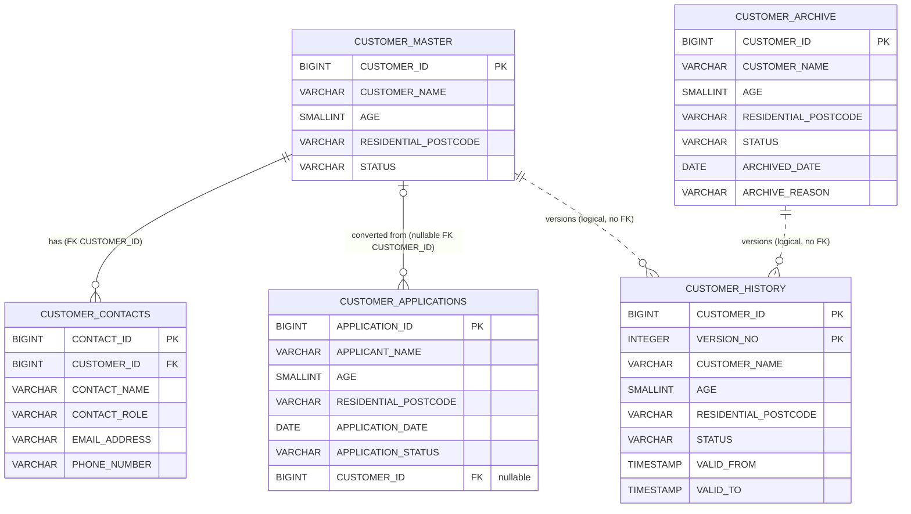

# Customer domain ERD (FICTIONAL DEMO)

This diagram is for people only. The MCP server does not serve it. The source of truth is:

- `context/schema/customer/*.sql`: table DDL and declared foreign keys
- `context/business-rules/customer/customer-table-relationships.md`: grain, keys and documented relationships

If you change either of those, update this diagram to match.

All tables are in schema `APP`. The diagram leaves the prefix off because Mermaid entity names can't contain dots.

## Reading the diagram

- **Solid lines** are foreign keys declared in the DDL.
- **Dotted lines** are relationships described in the rules but not enforced. `CUSTOMER_HISTORY.CUSTOMER_ID` can belong to a current customer or an archived one.
- **There is no link between `CUSTOMER_ARCHIVE` and `CUSTOMER_MASTER`.** An archived customer no longer has a row in the master table.
- **Joining contacts repeats customer rows.** It's one-to-many, so use `COUNT(DISTINCT CUSTOMER_ID)` or aggregate contacts before joining.
- **Applicants aren't customers.** `CUSTOMER_APPLICATIONS.CUSTOMER_ID` is NULL until an application is converted.
