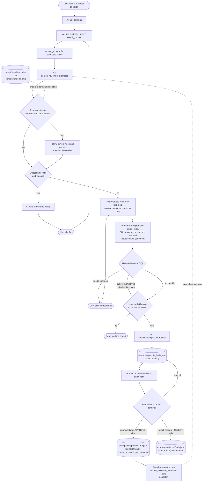

# sqlgenerator workflow

The AI client (Claude Code or GitHub Copilot) generates SQL. The `sqlgenerator`
MCP server only supplies context and stores examples. Nothing in this workflow
connects to Db2 or executes SQL.

## Loops

- **Clarification loop:** ambiguity → the AI asks → the user answers → the AI retrieves context again if needed.
- **Revision loop:** the user asks for changes → the AI regenerates with the same context rules.
- **Example-reuse loop:** a human-approved example becomes searchable immediately and informs later
  questions as a *pattern*. If `contextVersion` changes, the example is flagged
  `contextCheck.stale: true`, and current rules take precedence.

## What each status means

| Status | Where | Served by MCP? | Meaning |
|---|---|---|---|
| `pending` | `examples/pending/` | No | Submitted at the user's explicit request; awaiting human review |
| `approved` | `examples/approved/` | Yes | A human typed the confirmation phrase. **Not executed.** |
| `rejected` | `examples/rejected/` | No | Kept with reason and reviewer name for audit |
| demo seed | `examples/demo/` | No | Fictional practice record; `seed-demo` copies it to pending |
